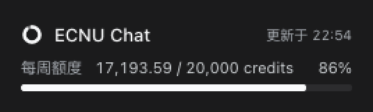
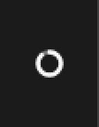
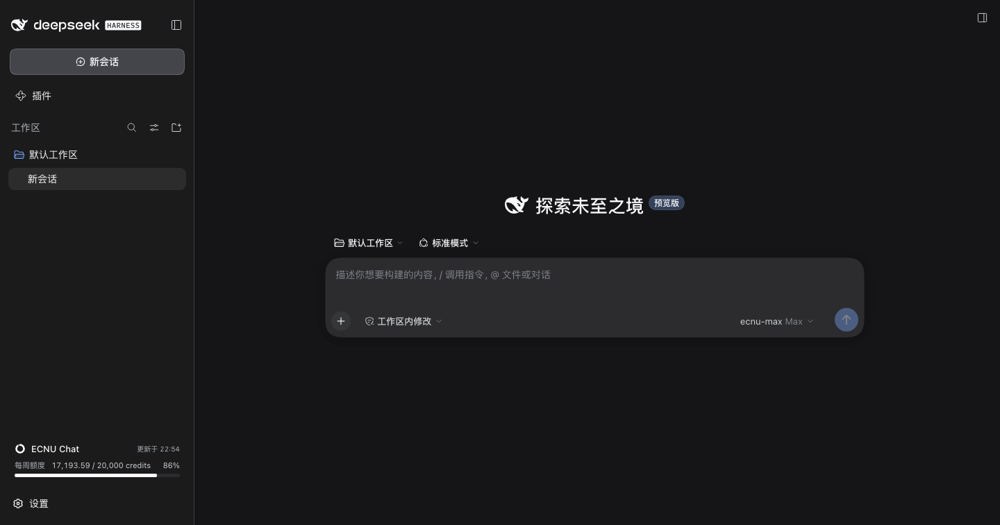
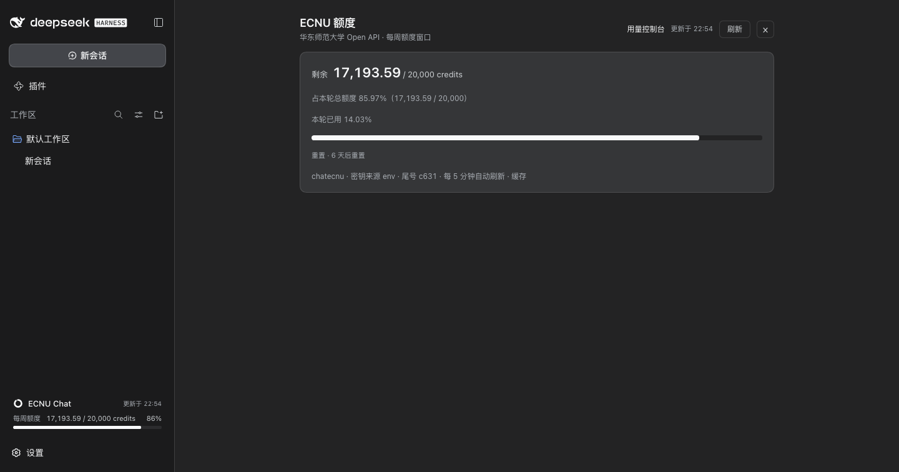

# dsh-ecnu-quota

在 DSH 网页界面里展示 **ECNU（华东师范大学 chat.ecnu.edu.cn）Open API 额度**，做法参照 `dsh-qoder-connect` 的额度展示：宿主半提供一条只读状态路由，客户端半在侧边栏底部放一张卡片、在主面板放一个详情页。

```
ECNU 额度
剩余 17,193.59 / 20,000 credits
占本轮总额度 85.97%（17,193.59 / 20,000）
本轮已用 14.03%
━━━━━━━━━━━━━━━━━━━━━━━━━━━━━━━━━
重置 · 6 天后重置
```

## 组成

| 文件 | 角色 | 说明 |
| --- | --- | --- |
| `lib/index.js` | 宿主半（Node/ESM） | 通过 `ctx.credentials` 解析 `ECNUCHAT_API_KEY`，请求 ECNU 额度接口，并以回环限定的 HTTP 路由输出规范化 JSON。15 秒内存缓存。 |
| `lib/client.js` | 客户端半（浏览器 bundle） | 手写的 `window.__ModuleLoader__.load({...})` 包，只依赖 `react`。注册侧边栏底部额度卡片（唯一入口）与 `ecnu-quota-panel` 详情面板，5 分钟轮询一次宿主路由。样式体系与 `dsh-qoder-connect` 对齐（见下文「界面」）。 |
| `cordis.patch.yml` | bundle 补丁 | `- insert: [{ id: ecnu-quota, name: dsh-ecnu-quota }]`，即 profile 里那一行插件。 |
| `tools/boot-probe.mjs` | 离线自检工具 | 用应用自带的 Electron 以 Node 模式启动 profile 的临时副本，打印 `skippedBundles`、未激活条目、注入的客户端 URL 与各路由状态码。 |
| `tools/verify-ui.mjs` | 浏览器实测工具 | 用 CDP 驱动无头 Chrome 打开自检实例，断言真实 DOM 与宿主路由数据一致（50 项），并截图。 |

宿主半**不**依赖客户端半，客户端半出错只会在浏览器控制台留下 `[dsh-ecnu-quota] ...` 日志，不影响宿主。

## 开发注意（两个静默失败点）

1. **linked 包不能 `import "@deepseek-ai/…"`。** 包体是软链接进 profile 的，自己没有 `node_modules`，任何平台包的裸导入都会 `ERR_MODULE_NOT_FOUND`；cordis 只打一行 `ecnu-quota (dsh-ecnu-quota): failed to import`，然后整行不激活——**没有路由、也不会注入客户端 bundle**，界面完全静默、`/plugins/dsh-ecnu-quota/quota` 直接 404。平台能力一律通过 `ctx.inject([...])` / `ctx.get(...)` 获取。`credentialRef` 只是 `brandString` 的编译期品牌（运行时原样返回该字符串），所以本地校验 `^[A-Za-z_][A-Za-z0-9_]*$` 即可，见 `lib/index.js` 顶部。
2. **bundle 列表变化必须重启进程。** 包解析（`ResolutionRouter`）拒绝在运行中的进程里替换；`cordis.yml` 每次启动都会被宿主重写，因此**它的 mtime 就是当前进程的启动时刻**——若它早于 `package.json` 的 mtime，说明运行中的进程读的还是旧配置。

## 安装（desktop profile）

包本体留在工作区，profile 通过软链接引用，因此改完代码重启应用即可生效，不需要重新安装：

```jsonc
// ~/.dsh/profiles/desktop/package.json
{
  "dependencies": {
    "dsh-ecnu-quota": "link:../../../Documents/deepseek-harness/default-workspace/dsh-ecnu-quota"
  },
  "dsh": { "profile": { "bundles": [
    "@deepseek-ai/dsh-base",
    "@deepseek-ai/dsh-web-app",
    "@deepseek-ai/dsh-experimental-auto-review",
    "dsh-plugin-marketplace",
    "dsh-qoder-connect",
    "dsh-ecnu-quota"
  ] } }
}
```

```
~/.dsh/profiles/desktop/node_modules/dsh-ecnu-quota -> <工作区>/dsh-ecnu-quota
```

bundle 列表变化属于「包解析」变化，`ResolutionRouter` 会拒绝在运行中的进程里替换（`profile resolution: … requires a process restart`），**因此添加或改动这个插件后必须退出并重新启动 DeepSeek Harness Desktop**；重启后 `@deepseek-ai/dsh-hmr` 才会接管后续的补丁热更新。

## 配置项

在 profile 的 `cordis.patch.yml` 里给 `ecnu-quota` 那一行加配置即可（全部可省略）：

```yaml
- id: ecnu-quota
  config:
    apiKeyEnv: ECNUCHAT_API_KEY        # 凭据引用名
    quotaUrl: https://chat.ecnu.edu.cn/open/api/v1/quota
    consoleUrl: https://aiconsole.ecnu.edu.cn
    route: /plugins/dsh-ecnu-quota/quota
    cacheMs: 15000                     # 宿主缓存
    timeoutMs: 15000
```

`providerLabel` 可覆盖界面上的「ECNU Chat」标题。

## HTTP 契约

```
GET /plugins/dsh-ecnu-quota/quota[?fresh=1]
```

- 仅接受回环请求：`Host` 与 `Origin` 必须都是 `127.0.0.1` / `localhost` / `[::1]`，否则 `403 {"error":"request-not-trusted"}`。
- 非 `GET`/`HEAD` → `405`。`?fresh=1` 绕过 15 秒缓存。
- 成功（`200`）：

```jsonc
{
  "ok": true,
  "status": "ok",
  "provider": "ECNU Chat",
  "providerId": "chatecnu",
  "unit": "credits",
  "keySource": "stored-file",        // 只报来源
  "keyTail": "1a2b",                 // 只报尾号，绝不返回密钥
  "windows": [
    { "type": "fixed_168h", "limit": 20000, "used": 3285.36, "remaining": 16714.64,
      "usedPercent": 16.4286, "windowStart": "…", "resetAt": "…", "source": "first_request" }
  ],
  "totals": { "limit": 20000, "used": 3285.36, "remaining": 16714.64, "usedPercent": 16.4286 },
  "resourcePacks": [],
  "consoleUrl": "https://aiconsole.ecnu.edu.cn",
  "fetchedAt": "…", "cached": false
}
```

- 失败统一为 `200 {"ok":false,"status":"missing-credential|unauthorized|rate-limited|network|timeout|upstream|parse","kind":…,"message":"…"}`，界面按 `status` 显示对应的本地化文案。

密钥解析完全走 DSH 凭据服务（`ctx.credentials.resolve(<凭据引用>)`，引用名默认 `ECNUCHAT_API_KEY`），与 `dsh-llm-pi-ai` 的 `ecnuchat` 路由同源：启动环境变量 → 存储文件 → 项目 `.env` → harness home `.env`。密钥不会出现在响应里，日志里也会被 `safeMessage` 打掉 token。

## 界面

样式与 `dsh-qoder-connect` 的额度界面逐条对齐，装在一起时两张卡片看起来是同一套设计：

- **同一份样式来源**：样式表以 `<style data-dsh-ecnu-quota>` 注入 `document.head`，注入前先查同名字符串，重复加载不会叠加；类名统一前缀 `eqp-`（对照 qoder 的 `qdp-`），所以两个插件永不撞类名。
- **只走设计令牌**：颜色一律 `var(--dsw-alias-*)`（`bg-layer-1/2/3`、`border-l2`、`label-primary/secondary/tertiary`、`brand-primary`、`state-error-primary`、`interactive-bg-hover`、`bg-module-platform`），没有一处写死的色值，因此自动跟随明暗主题。几何与字号也照抄：卡片圆角 14px、提示块 12px、底部卡片 10px、胶囊 999px，标题 18/600、副标题 12 tertiary、`tabular-nums` 对齐数字。
- **一条 `_footerActions` 修正规则**：外壳的侧边栏底部是个 flex **行**，而每个占位者都声明整行宽度，横排时会被挤出竖列。本插件注入 `[class*="_footerActions"]{flex-direction:column}`——与 qoder 选择器完全相同，两者同时安装时幂等，只装一个时各自也成立。
- **底部卡片**（槽位 `sidebar.footer.action`，id `ecnu-quota`，`order: 20`）：本体是 `<button>`，结构为 `footTop`（圆环 + 服务名 + 更新时间）+ 每个额度窗口一行 `footRow`（`footHead` 显示窗口名/剩余总额/百分比，下方全宽 `footBar`）。环与条画的都是**剩余**比例，低于 20% 转 `state-error-primary`；填充宽度取 `max(2, percent)`，快用完时仍留一丝可见。折叠成 56px 窄栏时（`props.wide === false`）退化成只含圆环的 `railButton`：外壳会把底部列居中，`width:100%` 于是收缩成 20×36 的圆环命中区，额度数值移进 `title` 提示，`aria-label` 保持不变。
- **详情面板**（主面板槽位 `main` 的 `key: ecnu-quota-panel`）：`main`（`bg-layer-1`，整列滚动）→ `mainInner`（`max-width: 760px` 居中阅读列）→ `header`（标题/副标题 + 控制台链接 + 更新时间 + 刷新 + `✕`）→ `card`：剩余额度大字、`占本轮总额度 百分比（剩余 / 总量）`、`本轮已用 百分比`、全宽进度条、重置倒计时，最后一行小字是 providerId、密钥来源、尾号和刷新节奏。行的顺序与文案与 qoder 面板逐条相同，只在两处不同：qoder 的资源包表位置留了空白——ECNU 只发一个 `fixed_168h` 窗口、`resource_packs` 恒为空表，列出来不如不列；卡片里也没有身份行，标题栏已经写了服务名与副标题，再放一遍是重复。刷新走 `?fresh=1`，`✕` 或点会话返回。

**面板不占用侧边栏导航条目**：入口就是点底部卡片，所以在 `main` 槽位注册时带了 `key: PANEL_ID`，由 `layout.selectPanel` 切换。想恢复那条 `sidebar.panellist` 导航行，在 `apply` 里重新注册 `{name: "sidebar.panellist", id: PANEL_ID, order: 60, locale: NS, label: () => t("panel")}` 即可。

两者共用同一个快照 store（`useSyncExternalStore`），所以面板打开时与卡片显示一致，并在窗口重新获得焦点时自动刷新。样式表另带 `@media (prefers-reduced-motion:reduce)` 关掉过渡、`:focus-visible` 统一 `brand-primary` 焦点环。



## 验证

```bash
curl -s http://127.0.0.1:19387/plugins/dsh-ecnu-quota/quota | python3 -m json.tool
curl -s "http://127.0.0.1:19387/plugins/dsh-ecnu-quota/quota?fresh=1" | head -c 200
```

**重启之前先离线自检**（不动真实 profile：只复制 `package.json` / `cordis.patch.yml`，`node_modules` 走软链接，临时 `DSH_HOME`，副本跑在备用端口 19399）：

```bash
cd <工作区>/dsh-ecnu-quota
ELECTRON_RUN_AS_NODE=1 "/Applications/DeepSeek Harness.app/Contents/MacOS/DeepSeek Harness" tools/boot-probe.mjs
```

它会打印 `skippedBundles`、未激活条目（`failed to import` 会在这里现形）、`__DSH_BOOT__` 里本插件的客户端条目，以及路由状态码；退出码 `0` 表示自检通过（`2` = 路由没返回 200，`1` = 没启动起来）。临时 home 里没有凭据库，所以自检下路由返回 `200 {"status":"missing-credential"}` 属正常，它验证的是接线（激活 + 路由 + 客户端注入），真实密钥由运行中的应用验证。

自检输出里 `dsh-plugin-marketplace` 与 `dsh-qoder-connect` 的 `failed to import` 是既有噪声、与本插件无关（这两个包依赖平台运行时，在探针这种裸 Node 模式下拉不起来）；判定只看两条：`skippedBundles=[]`，以及 `dsh-ecnu-quota` 出现在 `boot entry` 里且 `quota -> 200`。

判断「当前运行的进程有没有读到配置」：看 `~/.dsh/profiles/desktop/cordis.yml` 的 mtime（它就是启动时刻，见上文）。`404` 表示当前运行的宿主进程里没有这个 bundle —— 此时重启应用；客户端 bundle 的 URL 一定带 `?rev=`，所以单独访问 `client.js` 的 `404` 不能说明任何问题。重启后刷新 http://127.0.0.1:19387 即可看到卡片与面板。

### 浏览器实测（可复现，不动正在运行的应用）

`--hold` 让自检实例继续服务，并把自己的带 token 的 URL 写到 0600 文件里；导出 `ECNUCHAT_API_KEY` 后路由会拿到真实数据，界面就能按真实额度断言：

```bash
cd <工作区>/dsh-ecnu-quota
ECNUCHAT_API_KEY=… ELECTRON_RUN_AS_NODE=1 "/Applications/DeepSeek Harness.app/Contents/MacOS/DeepSeek Harness" \
  tools/boot-probe.mjs --hold 600 --url-out /tmp/deq-url.txt      # 不导出 key 则只验证接线

# 另开一个终端，等 URL 文件出现后：
ELECTRON_RUN_AS_NODE=1 "/Applications/DeepSeek Harness.app/Contents/MacOS/DeepSeek Harness" \
  tools/verify-ui.mjs "$(cat /tmp/deq-url.txt)" http://127.0.0.1:19399/plugins/dsh-ecnu-quota/quota /tmp/deq-shots
```

`verify-ui.mjs` 自己拉起无头 Chrome（`--remote-debugging-port=9333`，`--no-sandbox` 是因为 Chrome 自身的沙箱无法在 DSH 的文件沙箱内初始化），逐项断言真实 DOM 后写截图：

- 样式表已挂上；底部卡片落在 `[data-slot="sidebar.footer.action"]` 里，其容器 `flex-direction` 是 `column`（那条载荷性修正真的生效了）；卡片是 `<button>`、圆角 10px、满宽、有 `aria-label`，更新时间写成 `更新于 HH:MM`。
- 卡片与面板的进度条宽度**等于宿主路由报出的剩余比例**（容差 1%，因为额度是活的，读路由与读 DOM 之间会变），折叠窄栏的圆环中心数字也等于剩余百分比。
- 面板结构与 qoder 一致：`占本轮总额度 87.57%（17,514.01 / 20,000）` 与 `本轮已用 12.43%` 两行按 qoder 的文案成文、两条占比互补（和为 100）、恰好一条进度条、且**没有**重复的身份行（`.eqp-cardHead` 不存在）、**没有** 44px 圆环（`.eqp-glyph` 数为 0）、**没有** 额度窗口表与资源包表（`.eqp-table` 数为 0）；点卡片能打开面板（`max-width: 760px`、`bg-layer-1`、卡片圆角 14px），「刷新」发出 `GET …/quota?fresh=1`，`✕` 把中栏还给会话，且全程无 `[dsh-ecnu-quota]` 控制台报错。
- 两张特写的像素也断言：先断言整页截图正好是视口尺寸（`1440x757`，这样裁剪坐标系才有意义），再断言圆环亮部落在裁剪框中心 ±4px、卡片文字落在内缩边距内。

注意：断言的是**数据一致性**而不是像素值，所以额度怎么变都成立。自检实例的凭据只走环境变量继承，**绝不要把真实凭据库软链进临时 home**（启动会往库里的 `client-connection/browser-session` 写记录）。

| 折叠窄栏（只留圆环） | 侧边栏底部卡片 | 详情面板（点卡片打开） |
| --- | --- | --- |
|  |  |  |

图名跟着状态走：`rail.png` 是折叠窄栏里那个 20×36 的圆环按钮，`sidebar.png` 是展开态的底部卡片，`quota-panel.png` 是详情面板。

`verify-ui.mjs` 会把侧边栏强制折叠再展开，所以 `sidebar.png` 不随 profile 里记住的展开状态变化（它还顺手把折叠态的整页图写进输出目录当 `collapsed.png`，只供排查、不是 README 用图）；`rail.png`（3x）与 `sidebar-card.png`（2x）都不是另拍一张，而是从上面那张整页截图里按元素实时外框裁出来的——两张特写各自带一条断言：圆环亮部必须落在裁剪框中心 ±4px、卡片文字必须落在内缩边距内，否则判定裁错了行。Chrome 的 `Page.captureScreenshot` 的 `clip` 在本环境里会忽略文档原点、拍回页面顶部（`getBoundingClientRect` 与 `DOM.getBoxModel` 给出的坐标一致，所以不是取值问题），所以特写一律走「整页截图 + 页面内 canvas 裁剪」。

`--no-sandbox` 是因为 Chrome 自身的沙箱无法在 DSH 的文件沙箱内初始化。

## 已知限制

- ECNU 目前只暴露一个 `fixed_168h`（每周）窗口且 `resource_packs` 为空；界面已按「多窗口 / 无资源包」的通用情况编写。
- 只覆盖 `ECNUCHAT_API_KEY`（即 `llm-pi-ai` 里 `ecnuchat` 路由用的那把 key）；`chatecnu` / `CHATECNU_API_KEY` 不在范围内。
- 客户端每 5 分钟轮询一次，宿主缓存 15 秒。
- 无构建步骤：`lib/client.js` 由 `dsh-client-modules` 原样提供给浏览器，必须是合法的浏览器 JS，且顶层就是 `__ModuleLoader__.load(...)` 调用。

## 许可

[MIT](LICENSE)。
